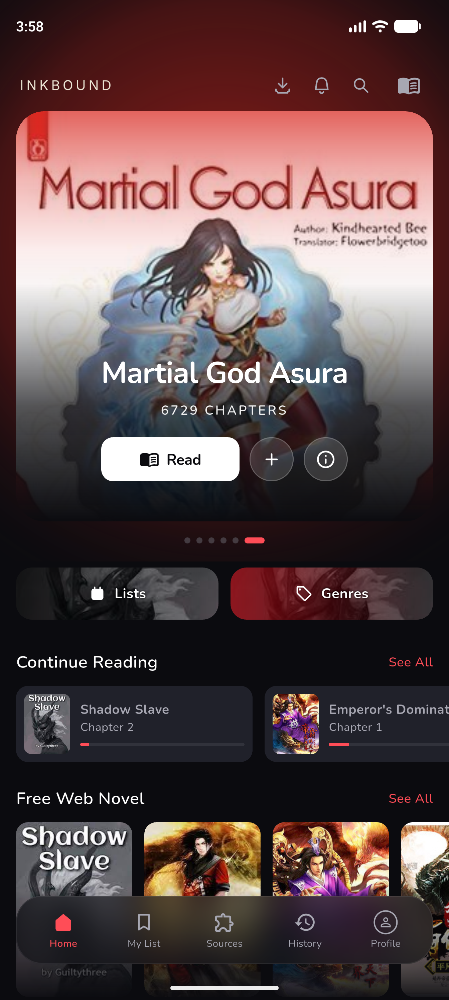
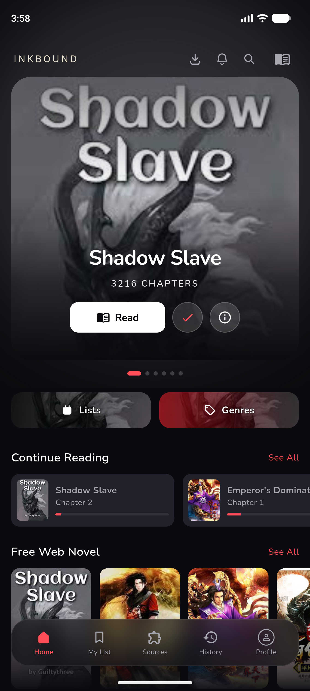

# ReadOra

Novels only. Local only. Yours.

Read novels from your own sources. No account. No cloud. Your library, history and progress stay on your device.

[](https://github.com/apauruseya7866er/Inkbound/releases/latest)

[](LICENSE)

### [Download the latest APK](https://github.com/apauruseya7866er/Inkbound/releases/latest)

Android 7.0 (API 24)+ · 75.5 MB · arm64-v8a / armeabi-v7a

---

<div align="center">

## Home

Your novel shelf — every installed source appears here, with pull-down to refresh. Tap any cover to open it.



---

## Audiobook player

One page for everything: cover art, waveform-style progress ring, transcript, and transport controls. Tap the cover to toggle the chapter number; tap any sentence to jump to it.



</div>

## ✨ Highlights

- **Read aloud with per-sentence highlighting** — the voice highlights each sentence as it speaks, and tapping any sentence jumps straight to it
- **Go at your own speed** — voice, speed, and pitch controls, plus a sleep timer that pauses without losing your place
- **Novel-only reader** — built for long-form text, with pagination, font control, and themes that adapt to light or dark mode
- **Read-aloud that works offline** — narration runs locally on your device, no account required

## 🎧 How narration works

Everything the reader shows and speaks comes from one segmented version of the chapter text — so the words you hear and the words you see always match.

1. **Sentence segmentation** — chapters are split into sentences by punctuation, so each sentence gets its own highlight block
2. **Sentence alignment** — each sentence is mapped to its position in the rendered text, so the highlight lands on exactly the right words
3. **Narration** — Android's text-to-speech engine reads each sentence, with voice, speed, and pitch controls you choose
4. **Follow along** — the page scrolls to keep the current sentence centered, and tapping any sentence jumps the voice to it

## 🧹 Text cleanup

Real sources ship with junk. ReadOra strips it out so the reader never reads it aloud:

- **Built-in rules** remove donation pitches, sleep-timer ads, and "read more" links — not just from the page, but from narration too
- **Long-press to hide** any sentence — the rule is global, so a repeated footer disappears from every chapter
- **Custom rules** — add your own patterns; they're matched literally (not regex), so punctuation is safe

---

## 📦 Install

1. Download the APK from the [releases page](https://github.com/apauruseya7866er/Inkbound/releases/latest)
2. Open it on your phone and allow install from your browser if Android asks
3. On first launch, the app seeds a source index so you have a catalogue immediately

**Verify the download (optional).** Releases are signed. The signing certificate's SHA-256 fingerprint is:

```
831ef2fefd7021f36f1be3e2d767aa0dcb960c1b9519346bc04413c3e564c0c8
```

> **Signing note.** If you install a release build and later build from source without `android/local.properties` containing `includeEmulatorAbis=true`, Android treats the builds as different signatures and won't let you upgrade — uninstall first.

---

## 🛠 Build from source

You need the [Flutter SDK](https://docs.flutter.dev/get-started/install) (Dart 3.x) and an Android toolchain.

```bash
git clone https://github.com/apauruseya7866er/Inkbound.git
cd ReadOra
flutter pub get
flutter run                  # debug build on a connected device
flutter build apk --release  # build/app/outputs/flutter-apk/app-release.apk
```

Release signing uses `android/key.properties`, which is not in the repository — see `android/key.properties.example` for the format.

**Stack:** Flutter and Dart, [Hive](https://pub.dev/packages/hive) for local storage, Kotlin `MethodChannel`s for the TTS engine, and the JavaScript engine for novel sources.

See [CONTRIBUTING.md](CONTRIBUTING.md) for CI, tests, and how to open a pull request.

---

## 📜 License

[GNU GPL-3.0](LICENSE). Copyright © 2026 ReadOra contributors.

</div>